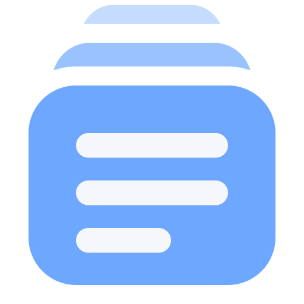
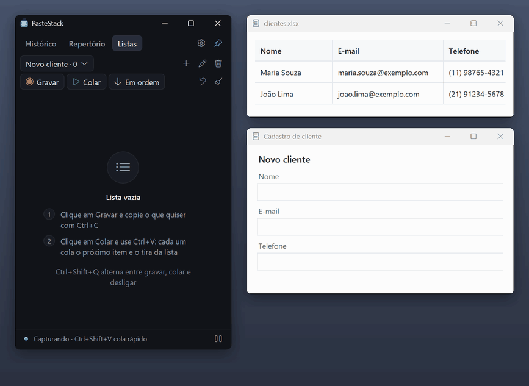
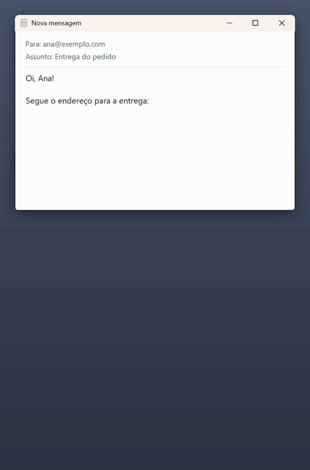
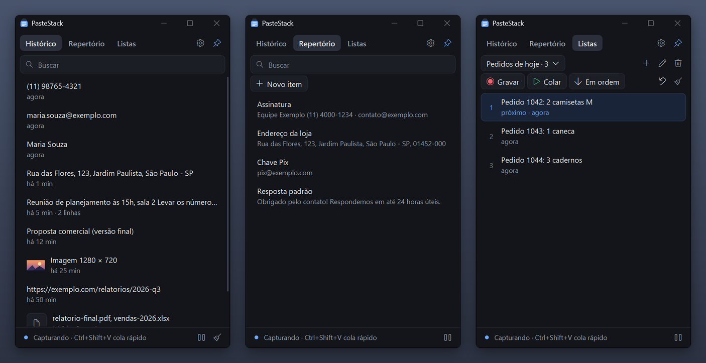
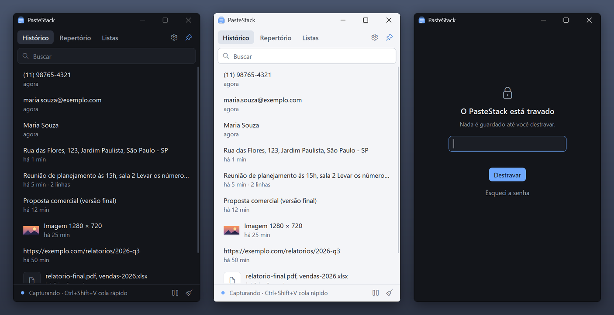
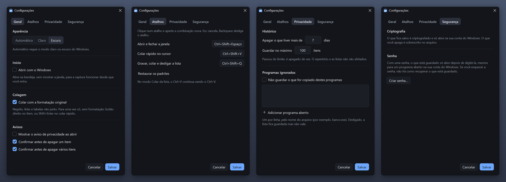
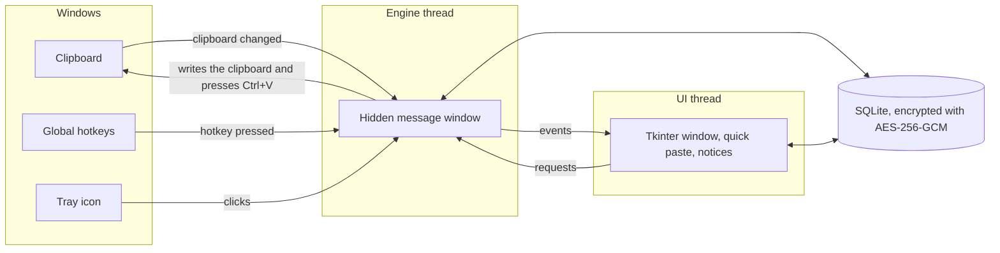

<p align="center">
  
</p>

<h1 align="center">PasteStack</h1>

<p align="center">
  A clipboard manager for Windows: a history of what you copy, saved snippets, and lists you paste back one
  <kbd>Ctrl</kbd>+<kbd>V</kbd> at a time.<br>
  Plain Python with no third-party packages, and everything it saves is encrypted.
</p>

<p align="center">
  
  
  
  
</p>

> The app's interface is in Brazilian Portuguese. The captions on the GIFs below are in English.

## See it in action

### Lists: copy several things, paste them back in order



1. Click **Gravar** (Record): every <kbd>Ctrl</kbd>+<kbd>C</kbd> also goes into the list.
2. Click **Colar** (Paste): every <kbd>Ctrl</kbd>+<kbd>V</kbd> pastes the next item and takes it off the list.
3. When the list runs out, <kbd>Ctrl</kbd>+<kbd>V</kbd> is a normal paste again.

The order can be reversed, items can be dragged around, and an undo button puts back the last item pasted.

### Quick paste, right where you are typing



<kbd>Ctrl</kbd>+<kbd>Shift</kbd>+<kbd>V</kbd> opens a small list under the text cursor, in any program.
- **Type** to filter.
- <kbd>Enter</kbd> pastes into the program you were in. <kbd>Shift</kbd>+<kbd>Enter</kbd> pastes without formatting.
- <kbd>Tab</kbd> switches between the history and your saved snippets.

<sub>Both GIFs were recorded from the real app with sample data. The spreadsheet, form and email windows are simple
stand-ins for other programs.</sub>

## Screenshots

**History, saved snippets (Repertório) and lists.** The history keeps text (with its formatting), images with a
thumbnail, and files copied in Explorer.



**Dark and light themes**, which follow Windows, and the **lock screen** when a password is set.



**Settings:** theme, start with Windows, formatting and confirmations; shortcuts; history limits and ignored
programs; password.



## Features

- **History.** Text, formatted text (HTML and RTF, so bold, links and tables survive), images and files. Search as
  you type. By default it keeps 7 days and 100 items, and deletes what goes past that by itself.
- **Repertoire.** Snippets you want to keep, with an optional title. Text can be edited.
- **Lists.** Record a sequence of copies, then paste it back in order or in reverse.
- **Quick paste.** A filterable list at the text cursor (or at the mouse, in programs that don't report their cursor).
- **Images and files.** Images are pasted back exactly as they were copied. Files are pasted as copies (never moved),
  or as their paths in a text field. If a file is gone, the app says so.
- **Global shortcuts**, all configurable. The app refuses combinations that would get in the way of typing, such as a
  single letter or <kbd>Ctrl</kbd>+<kbd>C</kbd>.

  | Default | Does |
  | --- | --- |
  | <kbd>Ctrl</kbd>+<kbd>Shift</kbd>+<kbd>V</kbd> | Quick paste |
  | <kbd>Ctrl</kbd>+<kbd>Shift</kbd>+<kbd>Space</kbd> | Show or hide the window |
  | <kbd>Ctrl</kbd>+<kbd>Shift</kbd>+<kbd>Q</kbd> | Cycle the list between record, paste and off |

- **Lives in the tray.** Closing the window keeps it capturing. The icon's color shows the state: blue capturing, red
  recording, green pasting, gray paused or locked.
- **Starts with Windows**, hidden in the tray, if you want it to.
- **Privacy controls.** Pause capture, ignore copies from chosen programs, and an optional password (see below).

## How it works



Two threads share the work. The **engine** owns a hidden window that receives what Windows announces (the clipboard
changed, a hotkey was pressed, the tray icon was clicked), and it does every clipboard write and simulated keystroke.
The **Tkinter UI** only draws. It asks the engine for things through a call queue and hears back through an event
queue, because Tk isn't safe to call from other threads. Every Windows API call goes through `ctypes`.

### The interesting parts

**<kbd>Ctrl</kbd>+<kbd>V</kbd> pastes the next item, without a keyboard hook.** A low-level keyboard hook would see
everything the user types. Instead, <kbd>Ctrl</kbd>+<kbd>V</kbd> is registered as a global hotkey only while paste
mode is on, so a real <kbd>Ctrl</kbd>+<kbd>V</kbd> reaches the app instead of the program in front. The app puts the
next item on the clipboard and presses <kbd>Ctrl</kbd>+<kbd>V</kbd> for the user with `SendInput`, briefly
unregistering its own hotkey so it doesn't catch itself. It pastes only once <kbd>V</kbd> is released, because
otherwise holding the key down would let auto-repeat empty the whole list.

**Encrypted storage using only what Windows ships.**
- **Encryption:** every text, title, image, thumbnail and list name is sealed with AES-256-GCM from Windows' own
  crypto library (CNG, `bcrypt.dll`) before it reaches SQLite.
- **The key:** it is wrapped with DPAPI, so a copied database file can't be opened from another Windows account or PC.
- **Optional password:** the key is also sealed with a key derived from the password (scrypt), and the copy that
  DPAPI alone could open is deleted.
- **Deleting:** SQLite's `secure_delete` overwrites deleted rows with zeros in the file.
- **Search and duplicates:** search decrypts in memory. Repeated copies are spotted with a keyed hash, so no plain
  text is stored for that either.

**Copying and pasting faithfully.**
- **What a copy keeps:** plain text, the HTML and RTF versions next to it, images as device-independent bitmaps, and
  file lists (`CF_HDROP`).
- **Thumbnails:** encoded as PNG by hand (`zlib` + `struct`), since no imaging library is used.
- **Password managers:** copies they mark as private (`ExcludeClipboardContentFromMonitorProcessing`,
  `Clipboard Viewer Ignore`) are never saved.
- **Windows' own history:** what PasteStack pastes asks Windows to stay out of the <kbd>Win</kbd>+<kbd>V</kbd>
  history and cloud sync.

**Quick paste at the caret.** The popup opens under the text cursor of the program in front (`GetGUIThreadInfo`),
falls back to the mouse, and flips above the cursor when there's no room below.

**Knowing when it can't paste.** Windows blocks simulated keystrokes into programs running as administrator (UIPI).
The app checks the target's elevation first, so it can say so and keep the item in the list instead of losing it.

**A modern look from Tkinter.**
- **Smooth shapes:** Tk's canvas draws jagged curves, so rounded corners, dots and checkboxes are small anti-aliased
  images generated at runtime.
- **Native touches:** the window is DPI aware and its title bar is colored to match the theme through DWM.
- **The logo:** drawn by code (`_icon_rgba` in `clipapp/win32.py`).

## Privacy and security

**It protects against** someone copying the database file, taking the disk, or opening it from another Windows
account, and against programs that just collect files. With a password, it also protects against a program running
in your account while PasteStack is locked.

**It can't protect against** malware already running in your account. That malware can read the clipboard the moment
you copy something (true on any PC, with or without this app), and it can read PasteStack's memory while it's
unlocked. So it's still best not to copy passwords or card numbers, or to pause capture first, or to ignore the
program they come from.

**Other details:**
- **Notice and confirmations:** capture only starts after a privacy notice, and deleting asks first. Both can be
  turned off in Settings.
- **Keystrokes:** the app never sees what you type. It only registers its shortcuts, and <kbd>Ctrl</kbd>+<kbd>V</kbd>
  only while in paste mode.
- **SSDs:** an SSD may keep old physical copies of a file. Anything left there is ciphertext, but no program can
  guarantee it's gone.
- **Where the data lives:** `%APPDATA%\ClipApp\clips.db`. Uninstalling leaves it in place.

## Install

Download `PasteStack-<version>-setup.exe` from the [Releases](../../releases) page.
- **No Python needed, no administrator rights:** it installs per user, in `%LOCALAPPDATA%\Programs\PasteStack`.
- **First run:** the installer isn't code-signed, so Windows shows "Windows protected your PC" the first time. Click
  **More info** → **Run anyway**.

## Run from source

Built and tested on Windows 11 with Python 3.14. Nothing to install: the app uses only the standard library.

```bash
git clone <this repository>
cd <repository folder>
pythonw PasteStack.pyw
```

`PasteStack.pyw --tray` starts it hidden in the tray, which is how "Start with Windows" launches it.

## Build the installer

```bash
py -m pip install nuitka
py tools/build_exe.py
```

- **What it makes:** `dist/PasteStack/PasteStack.exe` (compiled to native code by Nuitka), a zip of it, and
  `dist/PasteStack-<version>-setup.exe`.
- **The installer:** it needs [Inno Setup 6](https://jrsoftware.org/isinfo.php), and it closes a running PasteStack
  before updating.
- **Options:** `--no-installer` skips the installer, and `--installer-only` rebuilds just that.

## Tests

```bash
py -m unittest discover -s tests -p "test_*.py"
```

- **The 115 unit tests:** storage, encryption and the password, clipboard formats, ignored programs, shortcuts and
  start with Windows. They run in a few seconds.
- **Desktop tests:** two scripts drive the real desktop, with the real clipboard, hotkeys and keystrokes.
  - `tests/e2e_desktop.py` (about 1 minute): capture, recording and pasting lists, images, files and formatting,
    held keys and fast presses, quick paste, what reaches the disk, and a second launch.
  - `tests/e2e_ui.py` (about 3 minutes): the window, repertoire, lists, tray menu, settings, start with Windows, and
    the history deleting old items on its own.
  - **What they need:** the PC unlocked, PasteStack closed, and nobody clicking or copying while they run. They use a
    temporary data folder and a test registry key, so they don't touch your data or your startup settings. They do
    overwrite the clipboard: text is put back at the end, but an image or files are lost.

## Project layout

| Path | What it does |
| --- | --- |
| `PasteStack.pyw` | Launcher (no console window) |
| `clipapp/engine.py` | Background thread: capture, hotkeys, tray, pasting |
| `clipapp/ui.py` | The window, quick paste, notices and settings |
| `clipapp/clips.py` | What a copy holds: text, formatting, image or files |
| `clipapp/store.py` | Everything saved (SQLite) |
| `clipapp/crypto.py` | Encryption and password |
| `clipapp/win32.py` | The Windows API calls, through `ctypes` |
| `clipapp/paint.py` | Anti-aliased corners, dots and checkboxes for the window |
| `clipapp/autostart.py` | Start with Windows (the current user's Run key) |
| `tools/build_exe.py`, `tools/PasteStack.iss` | Build and installer |
| `tests/` | Unit tests and the two desktop tests |

**About the name:** the package is called `clipapp`, the project's working title. The data folder, the encryption
entropy, the window class and the single-instance mutex keep the old name on purpose, because renaming them would
leave existing saved data behind. The name people see lives in `APP_NAME`, in `clipapp/__init__.py`.

## Limitations

- **Windows only.** Clipboard, hotkeys, tray and encryption all go straight to Windows APIs.
- **Interface language:** Brazilian Portuguese only.
- **Huge images:** images over 64 MB uncompressed aren't saved. The app says so.
- **Programs running as administrator** don't accept the simulated <kbd>Ctrl</kbd>+<kbd>V</kbd>. The app notices,
  warns, and keeps the item in the list.
- **Unsigned installer:** see [Install](#install).

## License

[MIT](LICENSE)
